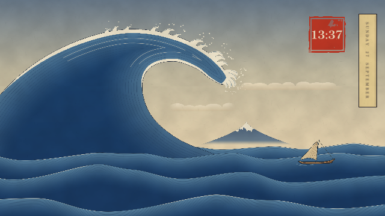
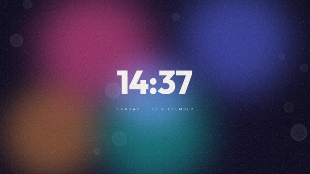
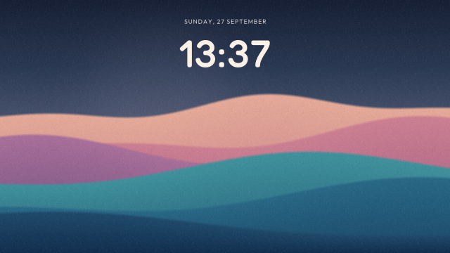
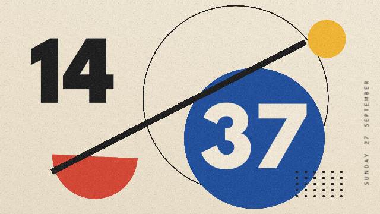
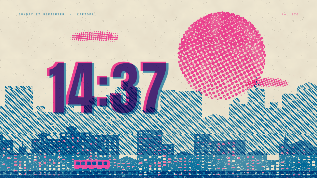
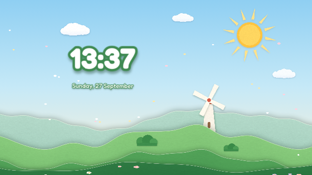

# Enzwall

Enzwall renders animated wallpapers on Wayland. Its TOML scenes combine images,
gradients, shapes and live text. Motion can respond to desktop changes, unlock,
wake and idle. Scenes can display the time, battery, system load or values sent
by another program.

| Kanagawa | Bloom | Tide |
| --- | --- | --- |
|  |  |  |
| **Bauhaus** | **Riso City** | **Papercraft** |
|  |  |  |

## Build and run

Build on Linux with Rust 1.95 or newer, pkg-config and the Wayland client
development libraries. Rendering requires an EGL driver with OpenGL ES 3.
Snapshots use surfaceless EGL and work without a running Wayland session.

```sh
cargo build --locked --release
./target/release/enzwall list scenes
./target/release/enzwall check scenes/tide
./target/release/enzwall snapshot scenes/tide tide.png --size 1920x1080 --time 6
```

To show Tide on a compositor that supports `wlr-layer-shell`, run the first
command in one terminal and send control requests from another.

```sh
./target/release/enzwall run scenes/tide --name demo --ready
./target/release/enzwall ctl --name demo status
./target/release/enzwall ctl --name demo event unlock
```

EnzimOS Shell uses the same command line and control socket. Hyprland can
report desktop changes automatically with `--hyprland auto`. Other shells can
send desktop and lock-screen events over the socket. See the
[control and integration guide](docs/ipc.md).

## Author and check scenes

Each scene directory contains a `scene.toml` and its assets. Use
`tools/make-previews` to render the bundled thumbnails or `tools/contact-sheet`
to inspect a scene at several aspect ratios and points in a transition. See
the [scene format reference](docs/format.md).

Run `scripts/check` for formatting, Clippy and the test suite.

Enzwall is MIT-licensed. The bundled fonts include their SIL Open Font License
notices and source records. [MIT license](LICENSE) · [Bundled fonts](scenes/_shared/fonts)
